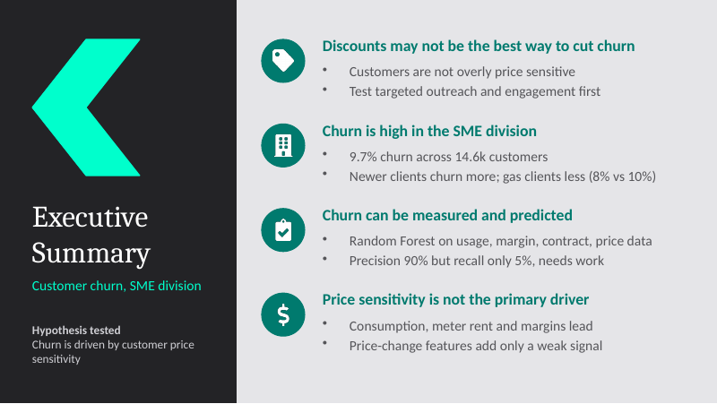
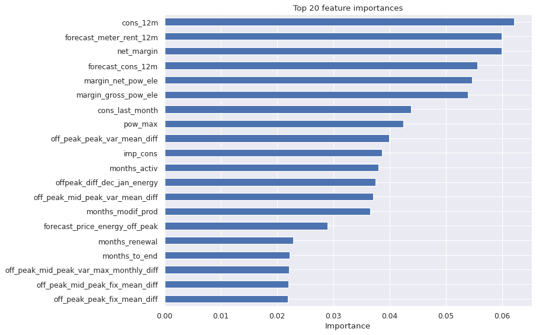

# PowerCo Customer Churn Prediction

Predicting why small and medium-sized business (SME) customers leave PowerCo, an energy utility, and testing whether **price sensitivity** is the cause.



## Business problem

PowerCo is losing SME customers. The hypothesis to test: **churn is driven by customer price sensitivity**. This project explores the data, builds features, trains a churn model, and answers whether discounts are the right retention lever.

## Key findings

- About **9.7%** of customers churned (1,419 of 14,606).
- Price sensitivity is **not the primary driver** of churn. Consumption, meter rent and margins rank highest.
- Price-change features appear in the top 20 but none dominates, so price is a weak-to-moderate signal.
- Newer clients churn more, and clients with gas churn slightly less (about 8% vs 10%).
- The Random Forest has high precision but very low recall, so it needs improvement before real use.
- **Recommendation:** discounts alone may not be the best strategy. Test targeted outreach and engagement first.

## Model results (Random Forest, 1000 trees, 75/25 split)

| Metric | Score |
|---|---|
| Accuracy | 0.904 |
| Precision | 0.905 |
| Recall | 0.052 |

Test set: 3,652 clients. True negatives 3,284, false positives 2, false negatives 347, true positives 19.

Accuracy looks good only because about 90% of clients do not churn. Recall shows the model finds very few real churners.



## Project structure

```
powerco-churn-prediction/
├── data/
│   ├── client_data.csv                          # client details and churn label
│   ├── price_data.csv                           # monthly energy and power prices
│   ├── data_for_modelling.csv                   # output of feature engineering
│   └── out_of_sample_data_with_predictions.csv  # test set with predictions
├── notebooks/
│   ├── 01_EDA.ipynb
│   ├── 02_Feature_Engineering.ipynb
│   └── 03_Modelling.ipynb
├── reports/
│   ├── Executive_Summary_Churn.pdf
│   └── Executive_Summary_Churn.pptx
├── images/
├── requirements.txt
└── README.md
```

## Workflow

1. **EDA** (`01_EDA.ipynb`): data types, missing values, distributions, outliers, churn by category.
2. **Feature engineering** (`02_Feature_Engineering.ipynb`):
   - price features: Dec-Jan off-peak difference, mean difference between periods, max monthly difference
   - tenure and date columns converted to months
   - one-hot encoding for sales channel and origin
   - log transform for skewed columns
   - correlation check and removal of redundant columns
3. **Modelling** (`03_Modelling.ipynb`): Random Forest, evaluation (accuracy, precision, recall), feature importance, saved predictions.
4. **Executive summary** (`reports/`): one-slide summary following the answer-first (pyramid) format.

## Data

| File | Rows | Description |
|---|---|---|
| `client_data.csv` | 14,606 | One row per client: consumption, forecasts, margins, contract dates, churn |
| `price_data.csv` | 193,002 | Monthly variable and fixed prices (off-peak, peak, mid-peak) per client |

Client IDs are anonymised hashes.

## How to run

```bash
git clone https://github.com/harshit-09-ds/powerco-churn-prediction.git
cd powerco-churn-prediction
pip install -r requirements.txt
jupyter notebook
```

Open the notebooks in `notebooks/` and run them in order (01, 02, 03). Paths are relative, so run them from inside the `notebooks/` folder.

## Tech stack

Python, pandas, NumPy, matplotlib, seaborn, scikit-learn, Jupyter.

## Next steps

- Improve recall: class weights, a lower prediction threshold, or resampling.
- Tune Random Forest parameters and compare with gradient boosting.
- Test targeted retention offers against outreach-based approaches.

## Author

Harshit - [GitHub](https://github.com/harshit-09-ds)
